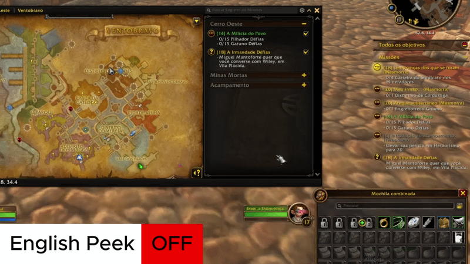

  

<h1 align="center">English Peek</h1>

<b>Hold a key to see names in English.</b> For World of Warcraft: Forever.

Playing in your own language but want to know what things are called in English (for guides, wikis, videos or talking to international players)? Hold **F12** and the names of quests, items, zones, dungeons and NPCs switch to English, right where they are. Let go and everything goes back to your language.

## Features

- **In place, instant:** the text itself changes. It is not a tooltip on top.
- **What gets translated:**
  - Quest titles and objectives (quest log, quest dialog, Questie tracker)
  - Items on every screen: tooltips, bags, merchant, loot, quest rewards, auction house, mail, trade, professions
  - Zones and subzones, maps and continents
  - Dungeons and raids
  - NPC names and titles (*Gryphon Master*, *Banker*…) in tooltips, the target frame and dialogs, and on nameplates when they are turned on (Blizzard and Plater). Names floating above heads are not changed (see [Limitations](#limitations)).
  - World objects (*Copper Vein*…), flight points, classes, races, professions and weapon skills
  - Optional: the **text painted on the world map**, using Map Fix Forever's images (see below)
- **Safe:** chat and anything players type are never touched, and player names are never translated. Nothing happens in combat (entering combat restores everything at once).
- **Lightweight:** uses Questie's existing data. No scanning, no data collection, and the game language is not changed.

## Requirements

- **Required:** [Questie](https://www.curseforge.com/wow/addons/questie) (with **QuestieDB**). English Peek takes all its English names from Questie's database.
- **Optional:** [Map Fix Forever](https://www.curseforge.com/wow/addons/map-fix-forever). Shows the text painted on the world map in English (see [English map art](#english-map-art-optional)). Keep it **disabled**.
- A non-English game client. Tested in Brazilian Portuguese, and it should work in any language Questie supports. On an English client the key does nothing.

## Installation

The easiest way is the **[CurseForge app](https://www.curseforge.com/download/app)**. It installs and updates everything:

1. Install [English Peek](https://www.curseforge.com/wow/addons/english-peek) from CurseForge. Questie is installed with it automatically as a required dependency.
2. Optional: install [Map Fix Forever](https://www.curseforge.com/wow/addons/map-fix-forever), then **disable it** in the AddOns list at character select.
3. Log in. A welcome window explains how to use the addon.

Manual installation: download [Questie](https://www.curseforge.com/wow/addons/questie) and [English Peek](https://www.curseforge.com/wow/addons/english-peek), then extract their folders into `World of Warcraft\_forever_\Interface\AddOns\`.

## Usage

- **Hold F12** to see English names. Release it to go back.
- To change the key, go to **Options → Key Bindings → AddOns → English Peek**, or click "Change key" in the welcome window.
  - F12 opens the backpack in default WoW. If F12 already had an action, the addon tells you in chat which one it replaced.
- Slash commands:
  - `/englishpeek`: shows the welcome window again
  - `/englishpeek status`: checks that everything is working
  - `/englishpeek test`: switches English on/off without holding the key

## English map art (optional)

The names painted on the world map images are part of the images themselves, so no addon can change them as text. English Peek can swap them for the original English images shipped with **[Map Fix Forever](https://www.curseforge.com/wow/addons/map-fix-forever)**:

1. Install Map Fix Forever.
2. **Disable it** in the AddOns list at character select. English Peek uses its images even while it is disabled. If it stays enabled, the maps are in English all the time.

## Limitations

- Only what exists in Questie's database can be translated. Spells, achievements and general interface text (menus, buttons) are not.
- Names floating above characters' heads (when nameplates are off) are drawn by the game engine and cannot be changed by addons. Turn nameplates on to see NPC names in English.

## Troubleshooting

Type `/englishpeek status`. Each line shows **OK**, **!** (works, but something changed) or **X** (that part is not working). After a Questie update, a part that shows "not found" usually needs an English Peek update. Please report it, and include the output.

## Contributing

Issues and pull requests are welcome. The project includes a `CLAUDE.md` with the full design notes (architecture, design decisions, maintenance steps), useful for anyone continuing development with or without AI tools.

To add a language for the addon's own messages, copy the `enUS` block in `Locale.lua` and translate it.

## Credits and license

- English data: [Questie](https://github.com/Questie/Questie) and QuestieDB.
- English map images and texture table: [Map Fix Forever](https://github.com/Pirson-s-Addons/MapFixForever) by Pirson (MIT). `MapArtData.lua` is a copy of its texture table and keeps its original MIT notice.
- English Peek by Conrado Saud, released under the [MIT License](LICENSE).
