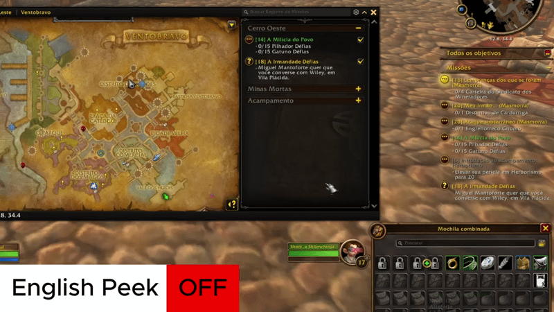

# English Peek

**Hold a key to see names in English.**

Playing World of Warcraft: Forever in your own language, but the guide, the wiki, the video or your group calls everything by its English name? Just hold **F12**: quest, item, zone, dungeon and NPC names switch to English, right where they are. Let go and everything goes back to your language.

## What changes to English

- **Quests:** titles and objectives in the quest log, the quest dialog and the Questie tracker
- **Items:** on every screen: tooltips, bags, merchant, loot, quest rewards, auction house, mail, trade, professions
- **Zones:** zones, subzones, maps and continents
- **Dungeons and raids**
- **NPCs:** names and titles (*Gryphon Master*, *Banker*…) in tooltips, the target frame, dialogs and nameplates
- **And more:** world objects (*Copper Vein*…), flight points, classes, races, professions and weapon skills

The text itself changes, right where it is. Nothing pops up on top of it.

## Getting started

1. Install English Peek. **Questie** is installed with it (it is required).
2. Log in. A short welcome window shows up.
3. Hold **F12** and look at your quest log, your bags or the map.

Want a different key? Go to **Options → Key Bindings → AddOns → English Peek**, or click **Change key** in the welcome window.

## English world map (optional)

The names painted on the world map images can also be shown in English. To enable this:

1. Install [Map Fix Forever](https://www.curseforge.com/wow/addons/map-fix-forever).
2. **Disable it** in the AddOns list at character select. English Peek uses its images only while you hold the key. If Map Fix Forever stays enabled, your maps are in English all the time.

## Good to know

- **Your chat is never touched**, and neither is anything players type. Player names are never translated.
- **Combat:** the key does nothing while you are in combat. If you enter combat while holding it, everything goes back to your language instantly.
- **Names above heads:** names floating above characters are drawn by the game itself and cannot be changed by addons. Turn on nameplates to see NPC names in English there.
- **Not translated:** spells, achievements and general interface text such as menus and buttons.
- **Languages:** works on any non-English game client. It is tested in Brazilian Portuguese. On an English client the key does nothing.
- **Built to last:** if a Questie update changes how its data is organized, English Peek tries to find it anyway. If something does stop working, it never causes errors: it simply skips that part and lets you know in chat. `/englishpeek status` shows what is working.

## Commands

- `/englishpeek`: shows the welcome window again
- `/englishpeek status`: checks that everything is working
- `/englishpeek test`: switches English on/off without holding the key

## Something not working?

Type `/englishpeek status` and send us the result in an [issue on GitHub](https://github.com/conradosaud/EnglishPeek/issues). After a Questie update, some parts may need an English Peek update.

---

English data from [Questie](https://www.curseforge.com/wow/addons/questie). English map images from [Map Fix Forever](https://www.curseforge.com/wow/addons/map-fix-forever) by Pirson.
